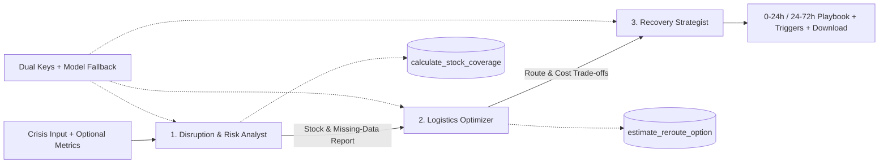
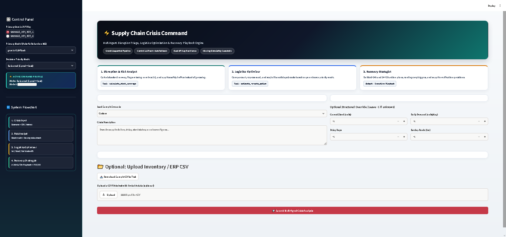
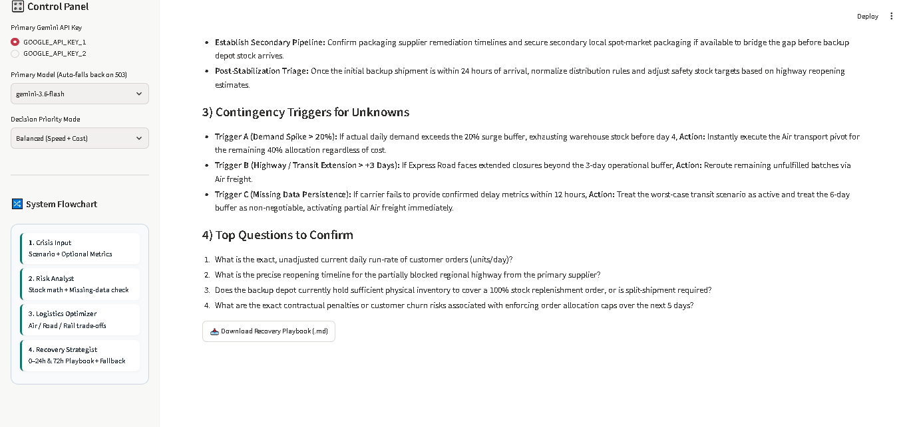

# Supply Chain Crisis Command (Multi-Agent AI)

An end-to-end **Multi-Agent Supply Chain Crisis Management System** built with **CrewAI**, **Google Gemini**, and **Streamlit**. It analyzes supplier disruptions, shipment delays, inventory shortages, and incomplete data to generate prioritized recovery playbooks.

---

## Live Demo & Repository

- **Live Deployed App:** [Launch Supply Chain Crisis Command](https://your-streamlit-app-url.streamlit.app) *(Replace with your Streamlit Cloud URL)*
- **GitHub Repository:** [palwashamushtaq123/agentic-supply-chain-recovery](https://github.com/palwashamushtaq123/agentic-supply-chain-recovery)

---

## Problem & Solution

### Problem
Supply chain teams face compounding disruptions—supplier halts, port/highway delays, stock shortages, and missing or unconfirmed operational metrics. Manual spreadsheet triage is slow, and guessing missing numbers leads to risky logistics decisions.

### Solution
A sequential **3-agent CrewAI pipeline** supported by **deterministic Python tools**, **missing-data safety guardrails**, and **dual-key / multi-model fallback**:
- **Agent 1 — Disruption & Risk Analyst:** Evaluates stock coverage, flags missing inputs (`-1`), and applies conservative safety buffers rather than silently guessing.
- **Agent 2 — Alternative Sourcing & Logistics Optimizer:** Compares transport modes (`air`, `express_road`, `alt_sea_rail`) across transit time and cost based on the selected priority mode.
- **Agent 3 — Executive Recovery Strategist:** Synthesizes `0–24h` and `24–72h` recovery actions, contingency triggers for unknowns, and verification questions for suppliers/operations.

---

## System Architecture & Flowchart



### Architecture Highlights
- **Sequential Agent Collaboration:** Each downstream agent receives upstream findings as task context so routing and recovery actions stay grounded in actual stock exposure.
- **Tool-Grounded Math:** Inventory runway/shortfall and reroute cost/transit estimates are computed via custom Python `BaseTool` classes.
- **Incomplete Information Handling:** Missing metrics (`-1`) trigger explicit gap reporting, safety buffers (e.g., demand surge & delay buffer), and contingency rules.
- **Resilience & Fallback:** Handles transient `503` / `429` errors across `GOOGLE_API_KEY_1` / `GOOGLE_API_KEY_2` and fallback Gemini models.

---

## Project Structure

```text
.
├── app.py              # Custom HTML/CSS Streamlit dashboard, controls & Markdown export
├── crew_setup.py       # Dual-key/model fallback, Python tools, CrewAI agents & tasks
├── sample_crises.py    # Prebuilt crisis scenarios including incomplete-data edge cases
├── sample/             # UI screenshots and visual assets
├── .env.example        # Environment variable template
├── .gitignore          # Ignored files (.env, venv, cache)
└── README.md           # Project documentation
```

---

## Setup & Local Run

1. **Create and activate a virtual environment:**
   ```bash
   python -m venv venv
   .\venv\Scripts\Activate.ps1
   ```

2. **Install dependencies:**
   ```bash
   pip install crewai langchain-google-genai google-genai python-dotenv streamlit pandas
   ```

3. **Configure environment variables:**
   Copy `.env.example` to `.env` and add your keys:
   ```env
   GOOGLE_API_KEY_1=your_first_gemini_api_key
   GOOGLE_API_KEY_2=your_second_gemini_api_key
   GEMINI_MODEL=gemini-3.6-flash
   CREWAI_TRACING_ENABLED=false
   ```

4. **Launch the Streamlit app:**
   ```bash
   streamlit run app.py
   ```

---

## UI Screenshots

### Command Dashboard & Agent Cards


### Recovery Playbook (0–24h & 24–72h)


### Contingency Triggers & Verification Questions
