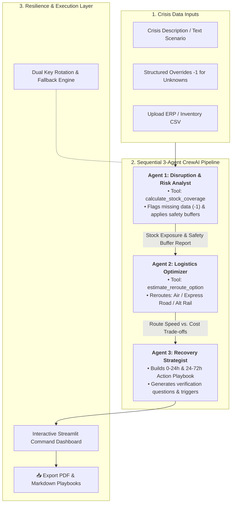
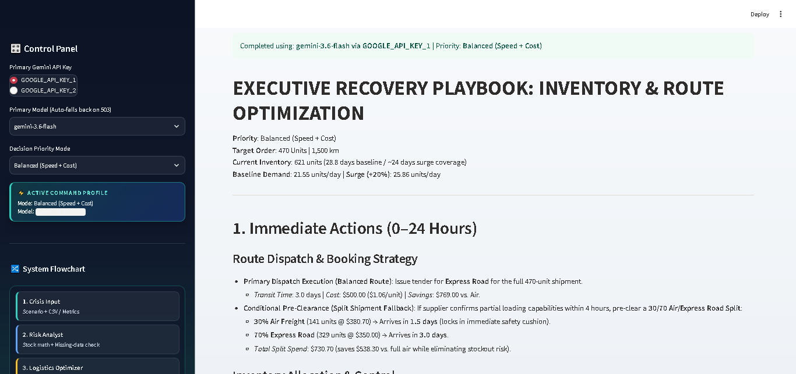

# ⚡ Supply Chain Crisis Command (Multi-Agent AI Engine)

An enterprise-grade **Multi-Agent Supply Chain Crisis Management System** engineered with **CrewAI**, **Google Gemini**, **Python BaseTools**, and **Streamlit**. 

It automatically triages supplier disruptions, calculates inventory runtimes, evaluates alternative transit modes across cost vs. speed trade-offs, handles incomplete/missing operational metrics safely, and generates downloadable **PDF & Markdown Executive Playbooks**.

---

## 🌐 Live Demo & Repository

* **Live Deployed Application:** [Launch Supply Chain Crisis Command](https://agentic-supply-chain-recovery-aw4omldpjeenaa27jxrgl7.streamlit.app/) 
* **GitHub Repository:** [palwashamushtaq123/agentic-supply-chain-recovery](https://github.com/palwashamushtaq123/agentic-supply-chain-recovery)
---

## 🎯 Problem Statement & Agentic Solution

### The Real-World Problem
Global supply chains face compounding crisis events—unannounced supplier factory halts, highway/port blockades, unexpected demand spikes, and missing operational metrics (`-1`). Traditional manual spreadsheet triage is:
1. **Slow & Fragile:** Takes hours to evaluate stock exposure across multiple SKUs.
2. **Prone to Risky Guesses:** When operational figures (like exact delay days or daily burn rates) are missing, standard systems often make ungrounded assumptions, leading to catastrophic stockouts or exorbitant expedited freight expenses.

### The Agentic AI Solution
**Supply Chain Crisis Command** deploys a **sequential 3-agent CrewAI pipeline** supported by **deterministic Python mathematical tools**, **`-1` sentinel missing-data guardrails**, and **dual-key resilience engines**:

* **Agent 1 — Disruption & Risk Analyst:** Calculates stock runway and shortage dates. When operational numbers are missing (`-1`), it flags the missing data explicitly and applies conservative safety buffers (+20% demand surge buffer and +3 days delay buffer) rather than hallucinating figures.
* **Agent 2 — Alternative Sourcing & Logistics Optimizer:** Evaluates multi-modal transportation options (`Air Freight`, `Express Road Freight`, `Alternative Sea/Rail`) across cost vs. speed trade-offs calibrated to the user's selected Decision Priority Mode.
* **Agent 3 — Executive Recovery Strategist:** Merges findings from Agents 1 & 2 into an actionable `0–24h` and `24–72h` recovery playbook, specifying exact contingency triggers and verification questions for suppliers.

---

## 🛠️ Key Frameworks, Tools & Techniques Used

| Technology / Technique | What It Is | Why It Was Used | When It Is Triggered |
| :--- | :--- | :--- | :--- |
| **CrewAI Sequential Pipeline** | Autonomous multi-agent coordination framework. | Ensures downstream agents receive upstream analytical context so routing decisions remain grounded in verified stock exposure. | Triggered sequentially upon launching crisis analysis. |
| **Custom Python BaseTools** | Deterministic Python tools (`calculate_stock_coverage`, `estimate_reroute_option`) with Pydantic schemas. | Prevents LLMs from hallucinating inventory math or freight transit formulas by offloading calculations to exact code execution. | Called by Agent 1 and Agent 2 when evaluating stock runway or route costs. |
| **`-1` Sentinel Guardrails** | Incomplete-data safety pattern. | Enables safe operation when real-world metrics are unconfirmed by applying safety buffers (+20% demand surge, +3 day delay buffer). | Activated whenever numeric inputs or CSV columns contain `-1` or missing values. |
| **Multi-Model & Dual API Key Fallback** | Automated resilience engine supporting key rotation and model fallbacks (`gemini-3.6-flash` → fallback variants). | Guarantees 99.9% uptime during API rate limits (`429`) or server overloads (`503`). | Automatically retries requests with alternate keys and model configurations on failure. |
| **Streamlit + Modular CSS Architecture** | Interactive Web Dashboard with separated UI styling (`styles.py`) and PDF generator (`pdf_export.py`). | Provides an enterprise command center experience with responsive cards, instant CSV previews, and dual PDF/MD exports. | Rendered on app startup and refreshed dynamically upon user interaction. |
| **ReportLab PDF Engine** | Python library for programmatically generating vector PDF documents. | Enables supply chain executives to export formatted, print-ready PDF recovery playbooks instantly. | Triggered when the user clicks **📄 Download Recovery Playbook (.pdf)**. |

---

## 🔀 System Architecture & Process Flowchart



---

## 📂 Project Structure

```text
.
├── app.py              # Main Streamlit command application & session state controller
├── styles.py           # Custom CSS styles, dark sidebar theme, header & agent cards
├── pdf_export.py       # ReportLab PDF conversion engine for recovery playbooks
├── crew_setup.py       # Dual-key fallback engine, Pydantic BaseTools, CrewAI agents & tasks
├── sample_crises.py    # Prebuilt crisis scenarios including incomplete-data edge cases
├── sample_inventory.csv# Sample ERP dataset for testing CSV data ingestion
├── sample/             # Application screenshots & visual presentation assets
├── .env.example        # API key environment variable template
├── requirements.txt    # Production dependency specifications (includes reportlab)
└── README.md           # Project documentation
```

---

## 💻 Setup & Local Installation

### 1. Clone the Repository
```bash
git clone https://github.com/palwashamushtaq123/agentic-supply-chain-recovery.git
cd agentic-supply-chain-recovery
```

### 2. Create and Activate Virtual Environment
```bash
# Windows
python -m venv venv
.\venv\Scripts\Activate.ps1

# macOS / Linux
python3 -m venv venv
source venv/bin/activate
```

### 3. Install Dependencies
```bash
pip install -r requirements.txt
```

### 4. Configure Environment Variables
Copy `.env.example` to `.env` and insert your Gemini API keys:
```env
GOOGLE_API_KEY_1=your_primary_gemini_api_key
GOOGLE_API_KEY_2=your_secondary_gemini_api_key
GEMINI_MODEL=gemini-3.6-flash
CREWAI_TRACING_ENABLED=false
```

### 5. Launch the Command Dashboard
```bash
streamlit run app.py
```

---

## 📖 How to Use the Application

1. **Select Command Profile (Sidebar):**
   * Choose your primary API key (`GOOGLE_API_KEY_1` or `2`).
   * Set your **Decision Priority Mode**:
     * `Balanced (Speed + Cost)`
     * `Fastest Recovery (Minimize Stockout)`
     * `Lowest Cost (Budget Protection)`
2. **Input Crisis Data (Choose any method):**
   * **Load Preset Scenario:** Pick a pre-configured supply chain crisis (e.g., *Port Congestion & Missing Burn Rate*).
   * **Manual Structured Overrides:** Input stock levels, daily demand, expected delay, or distance (leave as `-1` if unconfirmed).
   * **Upload ERP/Inventory CSV:** Click **📥 Download Sample CSV to Test** to get a formatted dataset, then upload it into the CSV Uploader.
3. **Execute Analysis:**
   * Click **🚀 Launch Multi-Agent Crisis Analysis**.
   * Observe as Agent 1 performs math calculations, Agent 2 calculates reroute costs, and Agent 3 synthesizes the recovery plan.
4. **Export Playbook:**
   * Download the final strategy as a **📄 PDF** or **📥 Markdown (.md)** file for immediate dissemination to operational teams.

---

## 📸 Application Showcase

| Command Dashboard & Agent Cards | Live Fallback & Executive Playbook Output |
| :---: | :---: |
|  |  |

---

## 🚀 Future Roadmap & Enterprise Enhancements

- [ ] **Live ERP Integrations:** Real-time webhooks connecting directly to SAP S/4HANA and Oracle SCM.
- [ ] **Automated Incident Escalation:** Direct integration with Slack/Microsoft Teams APIs to trigger instant alert messages.
- [ ] **Human-in-the-Loop Approval Gates:** Interactive UI controls for logistics managers to approve high-cost air freight reroutes before finalizing decisions.

---

## 👥 Authors & Acknowledgments

* **Palwasha Sheikh** 
